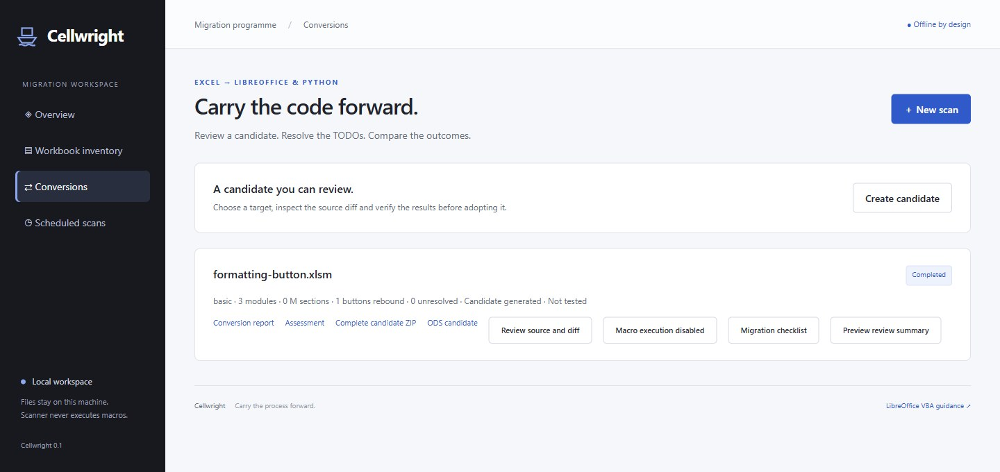

# Cellwright

[](https://github.com/scottcampbelldata/Cellwright/actions/workflows/ci.yml) [](https://github.com/scottcampbelldata/Cellwright/releases) [](LICENSE)

Offline Excel VBA inventory, assisted conversion to LibreOffice Basic/Python, Power Query migration to pandas, and a local migration dashboard. The scanner is one Rust executable and needs neither Office nor Python. The full archive includes optional Python tools; UNO targets also need LibreOffice. Desktop Excel is needed only to capture new Excel goldens.

## Start

Download the full Windows or Linux archive from [Cellwright releases](https://github.com/scottcampbelldata/Cellwright/releases). Extract it, then double-click **Start Cellwright.cmd** on Windows or run **start-cellwright.sh** on Linux. The launcher opens the existing dashboard with macro execution disabled. Setup checks explain missing software; **Scan demonstration workbook** starts an owned example without running its macros. [Project website](https://cellwright.scottcampbell.io/).



```powershell
cellwright.exe scan C:\Finance --out .\reports\finance --no-source
cellwright.exe extract .\Budget.xlsm --out .\reports\budget-source
cellwright.exe convert .\Budget.xlsm --out .\candidate --target basic
cellwright.exe serve --port 8768 --data .\reports\dashboard
```

Open http://127.0.0.1:8768 or http://localhost:8768 for scan history, assignments, schedules and conversion candidates. Macro verification is disabled by default; enable it for trusted workbooks with `cellwright.exe serve --allow-execution`, then consent to each case in the dashboard. Local programs can access the dashboard, so the startup flag grants them execution capability too. Linux comparisons require a saved Excel capture JSON for the same routine, inputs and cells. Python 3.11+ is required for these optional tools; the launcher tries `python`, then `python3` if `python` is absent. `CELLWRIGHT_PYTHON` selects an explicit interpreter without fallback. Install `requirements.txt` for standalone workbook/pandas targets. On Linux use `cellwright` without `.exe` and install `libreoffice-calc`/`python3-uno` for UNO targets.

From this checkout: `cargo build --locked --release`, then use `target/release/cellwright.exe`. Rust 1.99.0 is pinned. If Cargo is outside Windows PATH: `& "$env:USERPROFILE\.cargo\bin\cargo.exe" build --locked --release`.

## Inventory

Inputs are files, folders or UNC shares: `.xlsm .xlsb .xls .xlam .xla .xltm .xlsx`. Directory traversal skips symlinks and deduplicates overlapping paths. Destinations must be new or empty; output files never overwrite existing content.

Each scan writes offline `report.html`, UTF-8 BOM CSV inventories (`workbooks.csv`, `modules.csv`, `findings.csv`) and versioned `scan.json`. HTML supports search, sorting, findings, duplicates and estimates. CSV neutralises spreadsheet formula cells. `extract` adds VBA source, intact M sections, available UserForm designer CFB snapshots and an origin manifest. Designer snapshots are evidence, not converted LibreOffice dialogs.

The native bounded MS-OVBA parser extracts source, code page, types, references and protection. Inventory also includes UserForm control classes where readable, event entry points, OOXML assignments/connections/controls/links/Data Model, owner identifiers, signature presence, M names/steps/providers. Sixty built-in TOML rules operate on tokens, COM class strings, references and features. A generated LibreOffice IDL snapshot adds member checks for inferred common types. Declared members do not establish equivalent behavior.

```powershell
cellwright.exe scan \\server\share --out .\reports\share --lang de --no-source --skip-protected
cellwright.exe scan .\corpus --out .\reports\custom --rules .\data\rules.example.toml --weights .\data\weights.example.toml
cellwright.exe rules list --lang fr
```

`--lang en|fr|de` selects report/finding text. `--jobs` sets isolated workers (default 2); `--timeout` sets seconds per workbook (default 15). `--skip-protected` omits protected or unknown-protection VBA. `--no-source` excludes VBA, M and designer data and conflicts with `extract`; paths, names, owner IDs, references, hashes and findings remain visible. Dashboard scans default to source-free output.

Custom TOML rules replace/add IDs, with kinds `tokens`, `com`, `path`, `reference`, `feature` and English/French/German messages. Loaded configuration is frozen for workers and recorded in JSON. Examples are in `data/`.

Scan exits: `0` all discovered workbooks inspected, even with blockers; `1` discovery/encryption/skip/timeout/parse failure with reports retained; `2` CLI/configuration/output error. An inspected workbook can still have an unknown verdict.

Archive limits apply to expanded data: 16 MiB per ZIP part and 256 MiB across retained parts, with a 128 MiB on-disk workbook limit. Oversized non-VBA parts are skipped without decompression; their names and declared sizes are reported with MF060 and unknown coverage, while bounded VBA is still inspected. Oversized VBA and retained aggregate-size violations reject the workbook. Failed files contribute no effort estimate; skipped/unknown work is outside the estimated range.

## Conversion and evidence

Targets: `basic`, `basic-uno`, `python-uno` and standalone `python`/openpyxl. Local deterministic rules rewrite supported font/fill/alignment/wrapping/number-format assignments; Basic targets also produce editable UserForm layouts and reconnect eligible worksheet controls, including supported imported ActiveX models. Conversions keep originals, diffs, TODOs and candidate reports, creating new ODS files where applicable without running macros. Extracted M becomes pandas sidecars; unsupported features/providers fail explicitly. See the [conversion guide](docs/migration.md) for supported subsets and case examples.

```powershell
cellwright.exe migrate verify .\case.json --out .\proof --allow-execution
cellwright.exe migrate m-convert .\Section1.m --out .\query-candidate
```

A passing comparison proves only named routines, inputs and captured cells. Execution is opt-in for trusted code and is not sandboxed. Unsupported Basic code remains with TODOs; unsupported Python statements raise errors. Custom controls, modeless/dynamic forms, lifecycle events, complex object models, COM, Windows APIs, language coercion and external providers need human migration. openpyxl cannot calculate formulas.

## Coverage and development

The functional implementation spans milestones M0 to M9; [roadmap status](docs/architecture.md) records remaining release/validation gates. Binary XLS/XLSB features remain partial. Source/cache flags are heuristics, not full stomping detection; signatures are not validated. UserForm control counts have real-corpus checks; form candidates retain imported layouts with explicit control and event limits. Type/member inference cannot resolve every alias, shadowed name or dynamic call.

Estimates count each nonempty normalized module once plus per-workbook costs. String case and module type are preserved. The model uses base hours + code lines × line weight + capped finding weights + test hours. Empty modules cost zero; document modules containing only attributes, options or empty procedures omit base/testing overhead while retaining line and finding costs. Forms add two hours each plus 0.1 hour per control site, capped at 50 sites per form by default; MF050 retains its finding without a flat charge. Editable ranges are **uncalibrated planning assumptions** and exclude unknown work. Repeated deployment and integration work need separate estimates.

```powershell
cargo fmt --all -- --check
cargo clippy --locked --all-targets -- -D warnings
cargo test --locked
python -m pip install -r requirements.txt
python -m unittest discover -s tests -p "test_*.py"
```

[Validation](docs/validation.md) records Windows/Linux checks, controlled engine comparisons and fuzzing. [Corpus origins](corpus/README.md) distinguish public extraction data from owned executable fixtures. `scripts/crosscheck.py` compares extraction with olevba. `scripts/verify_corpus.py` and `scripts/verify_query.py` retain controlled-case evidence.

[Simulated estate validation](docs/calibration.md) generates 30 business workbooks and checks inventory, conversion and safe arithmetic candidates. These checks do not measure human migration effort or calibrate the hour estimates.

The [30-file real workbook stress test](docs/calibration.md) inspects all 30 files, including RelaxTools' 369 modules and 80 forms, with independent VBA extraction checks. CosMoS and Automated Invigilation retain their VBA inventories while oversized non-VBA parts are skipped with unknown coverage. [Per-file estimate comparisons](docs/examples/real-corpus-estimate-comparison.json) record the changes. Corpus files stay local and are excluded from releases; the hour estimates remain uncalibrated.

`scripts/package.py` creates full archives, CycloneDX SBOMs and hashes; see [release preparation](docs/releases.md). [Source is public on GitHub](https://github.com/scottcampbelldata/Cellwright), with [private vulnerability reporting](SECURITY.md). The preview archives are unsigned. Signing, independent mirror publication, representative pilots, language review and estimate calibration remain release gates.

[Français](docs/fr/quickstart.md) · [Deutsch](docs/de/quickstart.md) · [Security](SECURITY.md) · [JSON schema](docs/scan.schema.json)

License: EUPL-1.2. Public fixtures/dependencies retain their original licenses in `corpus/`, `third-party-licenses/` and `THIRD_PARTY_NOTICES.md`.
